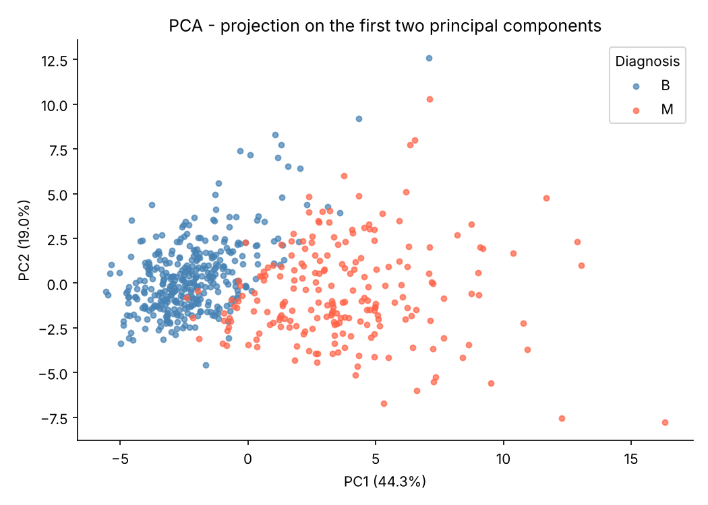
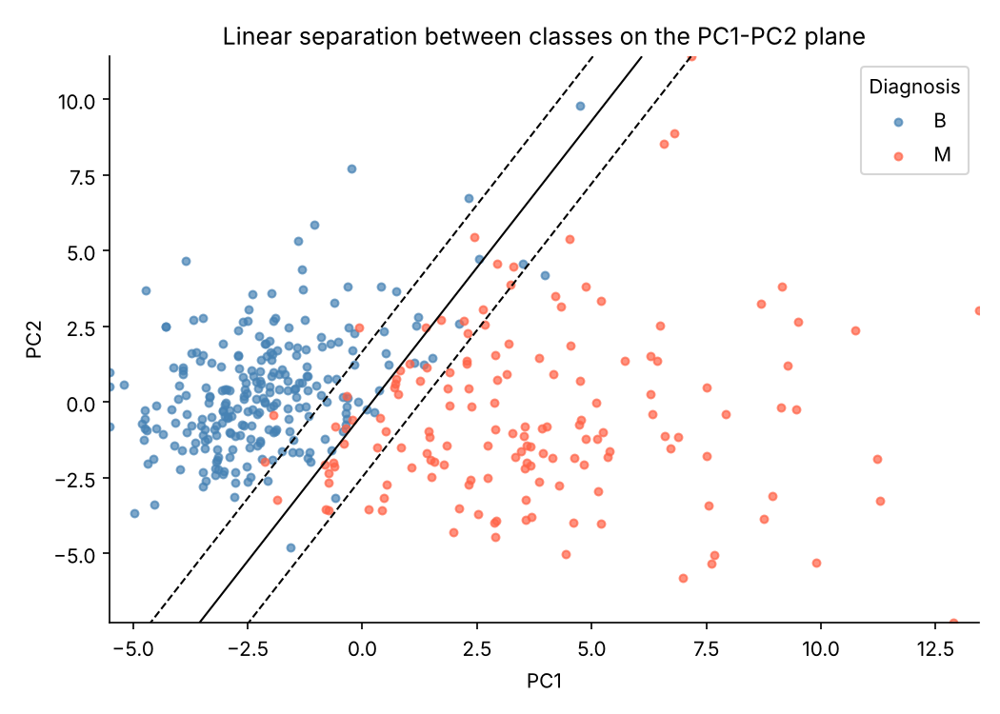
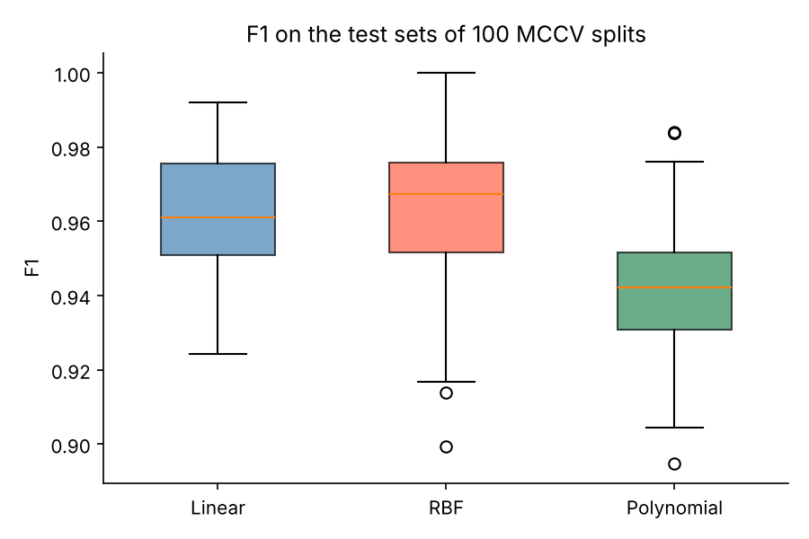
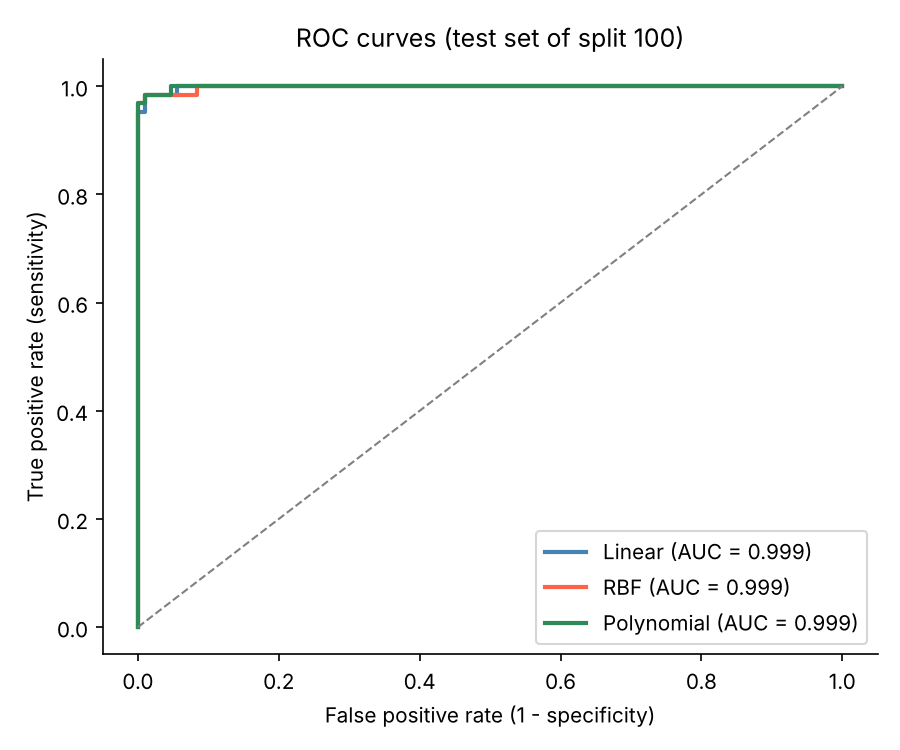
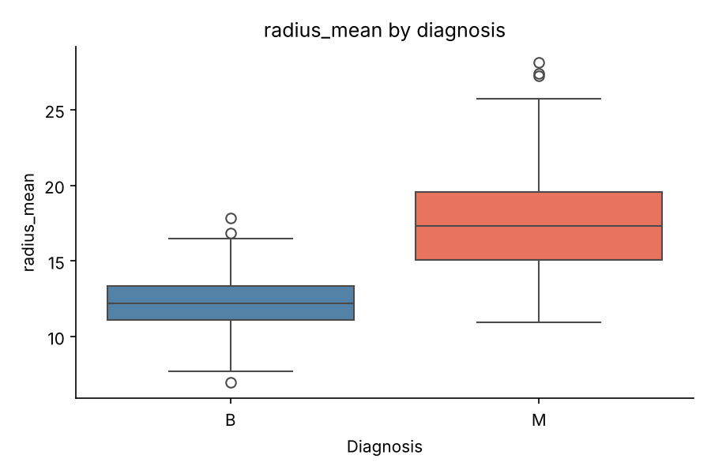
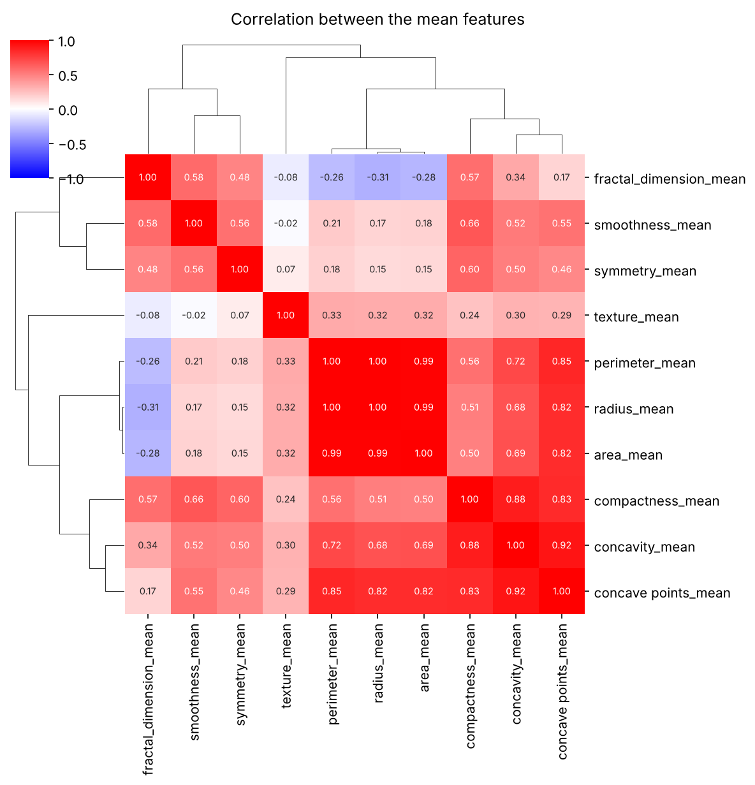

# Support Vector Machines for Breast Cancer Classification

This repository contains the bachelor's thesis **"Support Vector Machines per il machine learning con applicazione alla classificazione biomedica"** (*Support Vector Machines for machine learning with an application to biomedical classification*), written by **Gerardo Rainone** for the **Bachelor's degree in Statistics for Big Data** at the **University of Salerno** (Department of Economics and Statistics), **academic year 2024/2025**, under the supervision of **Prof. Pietro Coretto** (Statistical Learning).

The thesis is written in Italian. The code and this README are in English.

## Overview

The thesis has two parts:

1. **Theory** (Chapters 2-4): separating hyperplanes, the maximal margin classifier, the soft-margin support vector classifier and the role of the cost parameter `C`, Cover's and Mercer's theorems, the kernel trick (linear, polynomial and RBF kernels) and multiclass extensions (one-vs-one, one-vs-all).
2. **Case study** (Chapter 5): SVMs with linear, RBF and polynomial kernels are trained to classify breast masses as **benign** or **malignant** from morphological features of cell nuclei (Breast Cancer Wisconsin Diagnostic dataset), and compared on predictive performance and model complexity.

The original analysis was carried out in **R** (`e1071`, `caret`, `pROC`). This repository contains a **Python re-implementation** (`scikit-learn`) of the full pipeline.

## Documents

| Document | Description |
|---|---|
| [`docs/thesis.pdf`](docs/thesis.pdf) | Full thesis (Italian) |
| [`docs/abstract.pdf`](docs/abstract.pdf) | Abstract (Italian) |
| [`docs/presentation.pdf`](docs/presentation.pdf) | Slides used for the thesis defence |

## Repository Structure

```text
SVM-Breast-Cancer-Analysis/
├── README.md
├── requirements.txt
├── LICENSE
├── .gitignore
├── data/
│   ├── Cancer_Data.csv          # Breast Cancer Wisconsin (Diagnostic) dataset
│   ├── wdbc.names               # original dataset description
│   └── README.md
├── docs/
│   ├── thesis.pdf
│   ├── abstract.pdf
│   ├── presentation.pdf
│   └── figures/                 # figures generated by the Python code
├── src/                         # Python implementation
│   ├── __init__.py
│   ├── config.py                # paths, seed, splits, hyperparameter grids
│   ├── data.py                  # loading, cleaning, standardisation, stratified splits
│   ├── eda.py                   # exploratory analysis (Section 5.2)
│   ├── pca_boundary.py          # linear SVM on PC1-PC2 (Section 5.3)
│   ├── models.py                # SVM + grid search definitions
│   ├── train_evaluate.py        # Monte Carlo CV, tuning and evaluation (Sections 5.3-5.5)
│   └── summarize.py             # aggregation of the per-split results
└── results/
    ├── r_original/              # per-split results of the original analysis (thesis)
    └── python/                  # results produced by the Python code
```

## Dataset

The **Breast Cancer Wisconsin (Diagnostic)** dataset (WDBC) contains **569** fine-needle aspirate (FNA) samples of breast masses: **357 benign** (62.7%) and **212 malignant** (37.3%). Each sample is described by **30 numerical features**: ten characteristics of the cell nuclei (radius, texture, perimeter, area, smoothness, compactness, concavity, concave points, symmetry, fractal dimension), each summarised by its mean, standard error and "worst" value (mean of the three largest values).

See [`data/README.md`](data/README.md) for source, license and column description.

## Methodology

1. **Cleaning**: removal of the empty trailing column; check for missing values (none).
2. **Exploratory analysis**: class distribution, PCA projection, boxplots and correlation heatmap.
3. **Preprocessing**: the identifier `id` is excluded and the 30 features are standardised (centering and scaling). The scaler is part of the model pipeline, so it is fitted on the training data only.
4. **Monte Carlo cross-validation (MCCV)**: 100 stratified random splits, 70% training / 30% test.
5. **Hyperparameter tuning** inside each split with 10-fold cross-validation on the training set:

   | Kernel | Grid |
   |---|---|
   | Linear | `C` ∈ {0.01, 0.1, 1, 10, 100} |
   | RBF | `C` ∈ {0.1, 1, 10}, `gamma` ∈ {0.001, 0.01, 0.1} |
   | Polynomial | `C` ∈ {0.1, 1}, `gamma` ∈ {0.01, 0.1}, `degree` ∈ {2, 3, 4} |

6. **Evaluation** on each test set with **malignant** as the positive class: accuracy, precision, recall, F1-score, AUC (from the SVM decision values), plus the number of support vectors of each fitted model.

Both `e1071` (R) and `scikit-learn` (Python) are wrappers of **libsvm** and use the same kernel parametrisation, so the two implementations fit the same models.

## Results

Mean ± standard error over the 100 test sets.

**Python implementation:**

| Kernel | Accuracy | Precision | Recall | F1 | AUC |
|---|---|---|---|---|---|
| Linear | 0.972 ± 0.0011 | 0.982 ± 0.0016 | 0.943 ± 0.0029 | 0.962 ± 0.0016 | 0.995 ± 0.0005 |
| RBF | 0.973 ± 0.0012 | 0.985 ± 0.0018 | 0.943 ± 0.0029 | 0.963 ± 0.0017 | 0.995 ± 0.0005 |
| Polynomial | 0.959 ± 0.0013 | 0.982 ± 0.0018 | 0.905 ± 0.0032 | 0.942 ± 0.0019 | 0.991 ± 0.0007 |

**Original R analysis** (values reported in the thesis):

| Kernel | Accuracy | Precision | Recall | F1 | AUC |
|---|---|---|---|---|---|
| Linear | 0.971 ± 0.0012 | 0.981 ± 0.0020 | 0.942 ± 0.0032 | 0.960 ± 0.0017 | 0.965 ± 0.0015 |
| RBF | 0.974 ± 0.0012 | 0.986 ± 0.0016 | 0.944 ± 0.0029 | 0.964 ± 0.0016 | 0.968 ± 0.0015 |
| Polynomial | 0.956 ± 0.0015 | 0.983 ± 0.0017 | 0.897 ± 0.0040 | 0.937 ± 0.0022 | 0.944 ± 0.0020 |

**Model complexity** (average number of support vectors) and most frequently selected hyperparameters:

| Kernel | Support vectors (Python) | Support vectors (R) | Most selected hyperparameters |
|---|---|---|---|
| Linear | 49.0 | 47.0 | `C = 0.1` |
| RBF | 59.0 | 57.4 | `C = 10`, `gamma = 0.01` |
| Polynomial | 73.2 | 73.7 | `C = 1`, `gamma = 0.1`, `degree = 3` (every split) |

### Differences from the original R analysis

The Python code improves three details of the original R script; accuracy, precision, recall and F1 are practically unchanged, so the conclusions of the thesis still hold.

- The sample identifier `id` is excluded from the predictors (the R script used all numerical columns as features, `id` included).
- Standardisation is fitted on the training data only, inside the pipeline, instead of on the whole dataset before splitting.
- The AUC is computed from the continuous SVM decision values. In the R script it was computed from the predicted classes, which gives a single-point ROC curve: this is why the AUC values in the thesis are lower.

The remaining small differences are due to the different random splits generated by R and Python.

### Main findings

- All three kernels reach high performance, because the two classes are already **almost linearly separable** (see the PCA projection below).
- The **RBF** kernel obtains the best average metrics, but its advantage over the **linear** kernel is marginal and comes with more support vectors.
- The **polynomial** kernel has the lowest recall (≈ 0.90), i.e. it misses more malignant tumours: the most costly error in a clinical setting.
- Considering both performance and complexity, the **linear SVM** is the best trade-off for this dataset.

<p align="center">
  
  
</p>
<p align="center">
  
  
</p>
<p align="center">
  
  
</p>

*The sign of a principal component is arbitrary, so the PCA plots may appear mirrored with respect to the thesis.*

## Installation

```bash
git clone https://github.com/grainone28/SVM-Breast-Cancer-Analysis.git
cd SVM-Breast-Cancer-Analysis
pip install -r requirements.txt
```

## Usage

All commands are run from the repository root.

```bash
# Exploratory analysis: class distribution, PCA, boxplot, correlation heatmap
python -m src.eda

# Linear SVM on the first two principal components (decision boundary plot)
python -m src.pca_boundary

# Monte Carlo CV with tuning and evaluation of the three kernels (~2 minutes)
python -m src.train_evaluate

# Summary of the per-split results of the original analysis (thesis)
python -m src.summarize
```

`train_evaluate` saves to `results/python/`:
- `mccv_metrics.csv`: metrics, selected hyperparameters and support vectors for every split and kernel;
- `summary.csv`: mean and standard error of each metric;
- `support_vectors.csv`, `hyperparameters.csv`: model complexity and hyperparameter selection frequencies.

Figures are saved to `docs/figures/`. Use `--n-splits 10` for a quick run.

## Author

**Gerardo Rainone** - Bachelor's degree in Statistics for Big Data, University of Salerno

Supervisor: **Prof. Pietro Coretto**

## License

The source code is released under the [MIT License](LICENSE). The thesis, abstract and presentation in `docs/` are the author's academic work and are shared for consultation only; all rights reserved. The dataset is distributed under its own license (see [`data/README.md`](data/README.md)).
